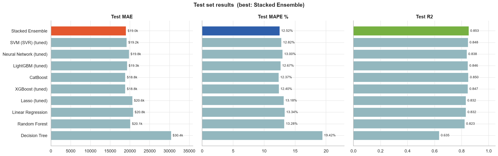
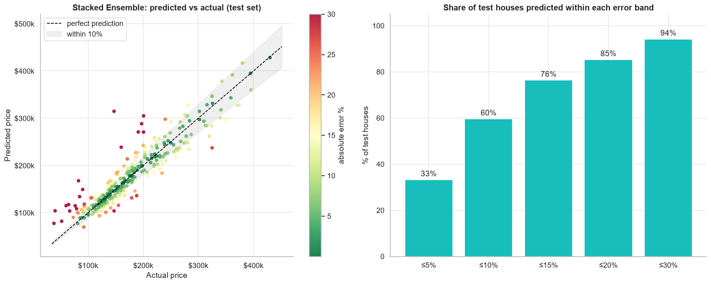
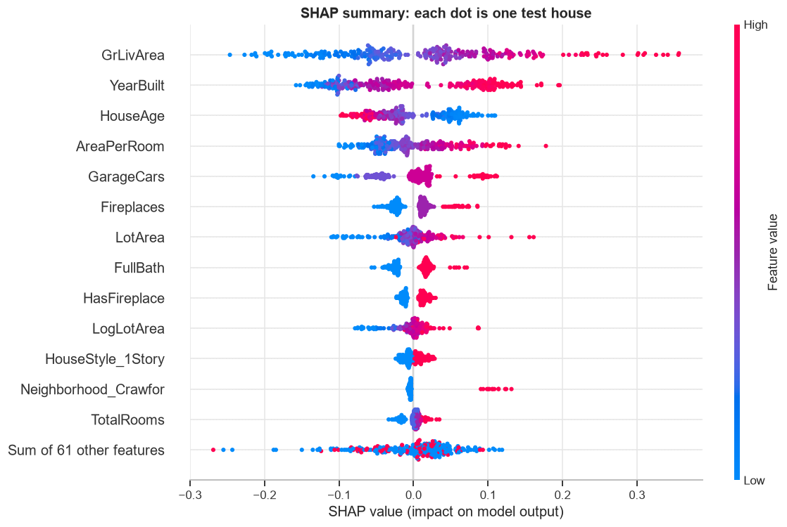
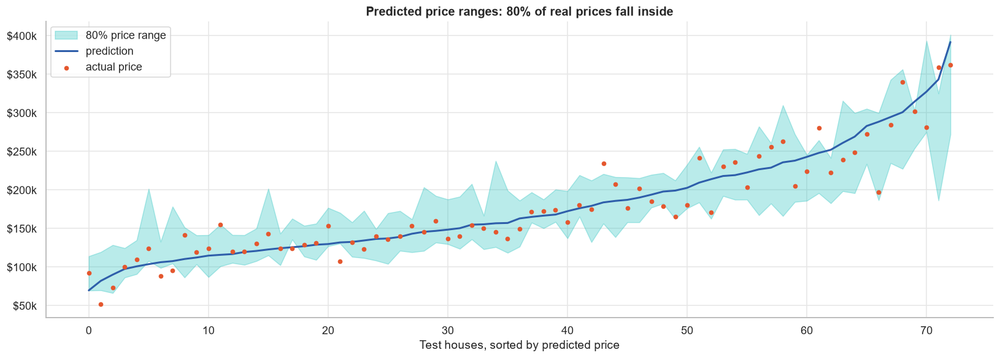
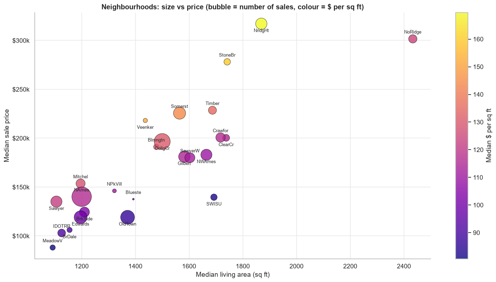
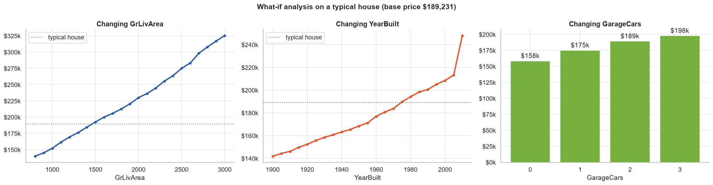

# House Price Prediction

[](https://colab.research.google.com/github/FaiazPronoy/House_Price_Prediction/blob/main/house_price_prediction.ipynb)


**Predicting what a house will sell for, with 13 machine learning models, a stacked ensemble and explainable AI.**

| | |
|---|---|
| **Course** | CSE422: Artificial Intelligence, BRAC University |
| **Semester** | Spring 2024, rebuilt in October 2026 |
| **Type** | Group project |
| **Made by** | Faiaz Abrar Zaman Pronoy, Sinthia Khandoker and Md. Jahirul Islam Zishan |
| **Versions** | [v1.0, the course submission, and v2.0, the rebuild](../../releases) |

---

## Results

Scores on 292 houses that no model saw during training or tuning.

| Metric | Result |
|---|---|
| R² | **0.853** |
| Average error | **$19,037** (12.5% of the price) |
| Priced within 10% | **60%** of houses |
| 80% price range | holds **80%** of real prices |



| | |
|---|---|
|  |  |
|  |  |

---

## How it works

1. **Clean.** Drop the mostly empty `Alley` column, one duplicate row and two partial sales of very large houses.
2. **Explore.** Prices are skewed to the right, so every model learns log(price).
3. **Engineer features.** House age, total rooms, space per room, and yes/no flags for a garage and a fireplace.
4. **Split.** 80% for training. 20% is locked away as the test set, stratified by price.
5. **Build pipelines.** Filling gaps, encoding and scaling run inside each fold, so nothing leaks.
6. **Compare 13 models** with 5-fold cross-validation.
7. **Tune** the strongest ones with randomized search.
8. **Stack** five different models. A linear model learns how much to trust each one.
9. **Test once** on the locked set. The final model is picked by cross-validation, not by the test score.
10. **Explain** each prediction with permutation importance, SHAP and partial dependence.
11. **Give a range.** Quantile models, calibrated with conformal prediction, give an 80% price range.

## Models

| Family | Models |
|---|---|
| Baseline | Median price |
| Linear | Linear Regression, Ridge, Lasso |
| Neighbours | KNN |
| Trees | Decision Tree, Random Forest |
| Boosting | Gradient Boosting, XGBoost, LightGBM, CatBoost |
| Kernel | SVM (SVR) |
| Neural network | MLP with a Gaussian quantile scaler |
| Ensemble | Stack of LightGBM, XGBoost, SVR, Lasso and the MLP |

## What drives the price

- Living area matters most.
- Year built, neighbourhood and space per room come next.
- Fireplaces and garage size add smaller amounts.
- The most expensive neighbourhood has a median price 3.6 times the cheapest one.

## Extras

- `estimate_price()` returns a price and a likely range for any house you describe.
- What-if charts show the value of more space, a newer build or a bigger garage.
- A bargain finder lists houses that sold far below the model's price.



---

## Built with

| Part | Tools |
|---|---|
| Data | pandas, NumPy |
| Models | scikit-learn, XGBoost, LightGBM, CatBoost |
| Explainability | SHAP, scikit-learn inspection |
| Charts | Matplotlib, seaborn |

## Run it

- **Colab:** click the badge at the top. No setup needed.
- **On your computer:**

```bash
pip install -r requirements.txt
jupyter notebook house_price_prediction.ipynb
```

A full run takes about 15 minutes on a laptop CPU.

## Project structure

```
house_price_prediction.ipynb   the notebook
data/house_prices.csv          1,460 house sales
docs/images/                   charts used in this README
report/                        the course report (v1)
requirements.txt               Python packages
```

---

## Versions

| | v1.0 (2024) | v2.0 (2026) |
|---|---|---|
| Models | Linear Regression, Decision Tree, SVM | 13 models and a stacked ensemble |
| Testing | One train/test split | 5-fold cross-validation and a locked test set |
| Target | Price | log(price) |
| Explainability | A tree diagram | SHAP, permutation importance, partial dependence |
| Uncertainty | None | A calibrated 80% price range |

v1 reported an R² of about 0.999. The price column was still among the inputs, so the models could see the answer. v2 removes that leak. Its 0.853 is an honest score on unseen houses.

## Data

The [House Prices](https://www.kaggle.com/competitions/house-prices-advanced-regression-techniques) competition data on Kaggle. It has 1,460 sales from Ames, Iowa, between 2006 and 2010. This project uses 19 of its columns.

## Authors

- **Faiaz Abrar Zaman Pronoy**, lead developer
- **Sinthia Khandoker**
- **Md. Jahirul Islam Zishan**

## Licence

Copyright 2024-2026 Faiaz Abrar Zaman Pronoy, Sinthia Khandoker and Md. Jahirul Islam Zishan. All rights reserved.
You may read the code and run it to try it out. You may not copy it, hand it in
as your own work, or publish it. See [LICENSE](LICENSE).
